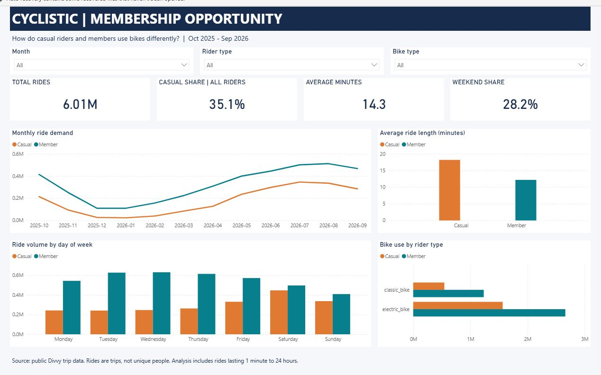
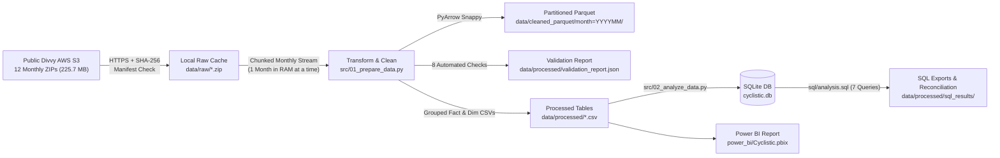

# Cyclistic Bike-Share ETL Pipeline & Analytics

**End-to-End Batch ETL Pipeline, SQL Reconciliation, and Power BI Report** · [Portfolio](https://github.com/MohammadKhairJaradat) · [CV](https://github.com/MohammadKhairJaradat/MohammadKhairJaradat/blob/main/Mohammad_Khair_Jaradat_CV.pdf)

**Python (pandas, PyArrow) · SQL (SQLite) · Partitioned Parquet · Power BI**

## Overview

This project combines a **student-level batch ETL pipeline** with the **Google Data Analytics Capstone** case study on Chicago's public Divvy bike-share dataset. It ingests 12 monthly archives (**6,171,785 raw trip records**, October 2025 – September 2026) from the public Divvy AWS S3 bucket over HTTPS, verifies file integrity via SHA-256 checksums, cleans and validates records **month-by-month out-of-core** so the full year never needs to sit in memory at once, writes **Snappy-compressed Partitioned Parquet** (`data/cleaned_parquet/month=YYYYMM/`), and loads analytical summary tables into **SQLite** and **Power BI**.

Beyond the engineering workflow, the project answers Cyclistic's core business question: *How do casual riders and annual members use bikes differently, and where should Cyclistic test membership offers?*



---

## Architecture



### Local vs. Cloud Execution
- **Cloud source:** Monthly raw `.zip` archives are hosted in the public Divvy AWS S3 bucket (`https://divvy-tripdata.s3.amazonaws.com/{YYYYMM}-divvy-tripdata.zip`) and fetched over HTTPS when not already cached locally.
- **Local storage & compute:** Checksum verification, chunked pandas transformations, Partitioned Parquet storage (`data/cleaned_parquet/`), SQLite query execution (`data/processed/cyclistic.db`), and Power BI modeling run locally without external cloud compute dependencies.

---

## Data Sources

- **Source:** [Divvy System Data](https://divvybikes.com/system-data), published under the [Divvy Data License Agreement](https://divvybikes.com/data-license-agreement).
- **Study window:** 1 October 2025 – 30 September 2026 (12 monthly archives, 365 calendar days).
- **Manifest tracking:** [`data/source_manifest.csv`](data/source_manifest.csv) records the exact `source_url`, download date, byte size (`236,705,265` bytes / `225.7 MB` total across 12 ZIPs), `sha256` hex digest, and `source_rows` (`6,171,785` total rows) for every monthly file.

---

## Pipeline Steps

The pipeline is orchestrated through a single CLI entry point ([`run_pipeline.py`](run_pipeline.py)) wrapping [`src/01_prepare_data.py`](src/01_prepare_data.py) and [`src/02_analyze_data.py`](src/02_analyze_data.py):

1. **Extract (`extract_month_archive`):**
   - Reads [`data/source_manifest.csv`](data/source_manifest.csv) and checks `data/raw/{YYYYMM}-divvy-tripdata.zip`.
   - Computes the local SHA-256 digest; if it matches the manifest, the download is skipped (**idempotent reruns**).
   - If an archive is missing or fails checksum verification, streams it from `https://divvy-tripdata.s3.amazonaws.com/` to a `.part` file and verifies its SHA-256 before moving it into place.
   - Supports full-year runs (`--all`) and targeted monthly backfills (`--months 202510 202511`).
2. **Transform (`transform_month_archive`):**
   - Streams each CSV directly from its `.zip` archive **one month at a time** (between `137,787` and `869,051` rows per monthly chunk) so peak memory scales with a single month rather than all 6.17M rows.
   - Applies eight sequential, non-overlapping cleaning rules (recorded per month in [`data/processed/cleaning_log.csv`](data/processed/cleaning_log.csv)) so every removed record has a single deterministic reason:
     - Missing `ride_id`: **0**
     - Duplicate `ride_id` (within or across monthly files): **35**
     - Invalid `member_casual` value: **0**
     - Invalid `rideable_type` value: **0**
     - Unparseable `started_at` / `ended_at` timestamp: **0**
     - Start timestamp outside `[2025-10-01, 2026-10-01)`: **71**
     - Duration `< 1` minute (false starts / negative durations): **159,221**
     - Duration `> 1,440` minutes (> 24 hours): **5,304**
   - Standardizes missing station names as `"Unknown station"` and derives calendar and time dimensions (`ride_date`, `year_month`, `weekday`, `weekday_order`, `day_type`, `hour`).
3. **Load (`Partitioned Parquet`, `CSV`, and `SQLite`):**
   - Writes cleaned trip-level partitions to `data/cleaned_parquet/month={YYYYMM}/trips.parquet` using PyArrow with Snappy compression (**12 partitions, 263.1 MB total**; excluded from Git via `.gitignore`).
   - Exports lightweight aggregated fact and dimension tables to [`data/processed/`](data/processed/) for version control and Power BI.
   - Loads `trip_summary`, `station_summary`, `cleaning_log`, and `rider_summary` into a local SQLite database (`data/processed/cyclistic.db`) and executes the seven analytical SQL queries in [`sql/analysis.sql`](sql/analysis.sql) (covering aggregations, `CTE`s, `LEFT JOIN`, and `LAG` window functions).

---

## Data Quality & Validation Checks

Every pipeline run executes eight automated checks and writes a structured report to [`data/processed/validation_report.json`](data/processed/validation_report.json):

| Check | Status | Verified Result |
|---|---|---|
| `missing_key_columns_check` | Passed | All 11 required columns (`ride_id`, timestamps, stations, rider/bike types, lat/lng) present across all 12 archives |
| `sha256_and_manifest_reconciliation` | Passed | All 12 monthly ZIPs match SHA-256 digests and exact `source_rows` in `source_manifest.csv` |
| `row_count_reconciliation_per_month` | Passed | `6,171,785` source rows = `6,007,154` clean rows (`97.33%`) + `164,631` removed rows across all 12 months |
| `duration_bounds_check` | Passed | `0` retained trips outside `[1, 1440]` minutes (`159,221` under 1 min and `5,304` over 24h removed) |
| `coordinate_bounds_check` | Passed | Chicago bounding box `[41.4, 42.5] N`, `[-88.3, -87.0] W`: `0` out-of-range coordinates; `0` missing start coords, `308` missing end coords |
| `month_and_date_coverage_check` | Passed | `12` contiguous `year_month` partitions and all `365` calendar dates present with `0` gaps |
| `cross_table_view_agreement` | Passed | `cleaning_log` (`6,007,154`) == `trip_summary` (`6,007,154`) == `station_summary` (`6,007,154`) |
| `sqlite_vs_pandas_reconciliation` | Passed | All 7 SQL queries in `sql/analysis.sql` match pandas totals and weighted average durations |

 Additional Power BI schema and DAX verification records are preserved in [`reports/validation.json`](reports/validation.json) and [`reports/power_bi_validation.json`](reports/power_bi_validation.json).

---

## How to Run

Use **Python 3.11+** in a local virtual environment:

```powershell
# 1. Create and activate a local virtual environment
uv venv .venv --python 3.12
uv pip install --python .venv\Scripts\python.exe -r requirements.txt

# 2. Run the full 12-month ETL pipeline (Extract -> Transform -> Validate -> SQLite & Charts)
#    Downloads missing ZIPs from Divvy S3 or verifies existing archives in data/raw/
.venv\Scripts\python.exe run_pipeline.py --all

# 3. Backfill / rerun specific months only (writes Partitioned Parquet & validates those months)
.venv\Scripts\python.exe run_pipeline.py --months 202510 202511

# 4. Run SQLite load, 7 SQL queries, and chart generation from committed processed CSVs (no raw ZIPs needed)
.venv\Scripts\python.exe run_pipeline.py --analyze-only

# 5. Run the test suite
.venv\Scripts\python.exe -m pytest -v
```

---

## Results & Business Findings

**Period:** 1 October 2025 – 30 September 2026 (`6,171,785` source trips → `6,007,154` cleaned trips; no sampling).

| Metric | Casual | Member |
|---|---:|---:|
| Rides | 2,110,304 | 3,896,850 |
| Share of rides | 35.1% | 64.9% |
| Average minutes | 18.17 | 12.17 |
| Median minutes | 11.14 | 8.69 |
| Weekend share | 37.2% | 23.3% |

- Casual trips were **1.49 times longer** on average (`18.17` vs. `12.17` minutes).
- **46.4%** of casual trips occurred in June–August 2026.
- Casual trips had a **37.2% weekend share**, compared with **23.3%** for members: a **13.9 percentage-point gap**. Both rider groups peaked around **17:00**.
- **Navy Pier** led recorded casual start stations (`24,148` casual starts). About **20.5%** of casual trips had no start-station name (`Unknown station`).

### Three Recommendations
1. Test seasonal membership offers before and during summer (June–August peak).
2. Test weekend and regular-use messages based on each group's riding pattern.
3. Pilot offers at high-volume casual start stations, with a control group to measure sign-ups and cost per conversion.

### Open the Power BI Dashboard
Download the repository and open [`power_bi/Cyclistic.pbix`](power_bi/Cyclistic.pbix) in **Power BI Desktop** (data is imported; Python and raw downloads are not required to view it). Editable PBIP source files, DAX measures, and setup instructions are in [`power_bi/README.md`](power_bi/README.md).

---

## Project Structure

| Path | Contents |
|---|---|
| [`run_pipeline.py`](run_pipeline.py) | Single CLI entry point (`--all`, `--months`, `--analyze-only`, `--force-download`, `--write-csv`) |
| [`src/01_prepare_data.py`](src/01_prepare_data.py) | S3 extraction, SHA-256 verification, chunked monthly cleaning, Partitioned Parquet export, and validation report builder |
| [`src/02_analyze_data.py`](src/02_analyze_data.py) | Summary table generation, SQLite database loader, SQL vs. pandas reconciliation, and chart exports |
| [`sql/analysis.sql`](sql/analysis.sql) | Seven analytical SQL queries: grouping, `CTE`s, `LEFT JOIN`, and `LAG` window functions |
| [`tests/test_pipeline.py`](tests/test_pipeline.py) | Automated `pytest` checks for manifest integrity, cleaning rules, Parquet output, and row reconciliation |
| [`data/source_manifest.csv`](data/source_manifest.csv) | Source URLs, download metadata, byte sizes, SHA-256 hashes, and row counts for all 12 monthly ZIPs |
| [`data/processed/`](data/processed/) | Reconciled summary CSVs, `validation_report.json`, and `sql_results/` exports |
| [`power_bi/`](power_bi/) | Native `Cyclistic.pbix`, editable `Cyclistic.pbip` source, DAX measures, and report screenshots |
| [`reports/case_study.md`](reports/case_study.md) | Executive summary, charts, recommendations, and analytical limitations |
| [`reports/methodology.md`](reports/methodology.md) | Cleaning rules, duration sensitivity analysis, and validation methodology |

---

## What I Learned / Next Steps

- **Out-of-core monthly chunking:** Processing 6.17M rows one monthly ZIP stream at a time keeps memory usage bounded (~1 month in RAM) while still enforcing cross-month deduplication on `ride_id`.
- **Reconciliation across storage layers:** Verifying that `source_rows == clean_rows + removed_rows` per month and asserting equality across Partitioned Parquet, grouped CSVs, SQLite queries, and Power BI DAX measures prevents silent data drift.
- **Next steps:** Add station coordinate enrichment via Chicago's public GTFS / weather APIs to quantify temperature and precipitation effects on casual vs. member ridership.

## Contact

[Email Mohammad Khair Jaradat](mailto:mohammad.sameer.jaradat@gmail.com) · [GitHub profile](https://github.com/MohammadKhairJaradat) · [CV](https://github.com/MohammadKhairJaradat/MohammadKhairJaradat/blob/main/Mohammad_Khair_Jaradat_CV.pdf)
