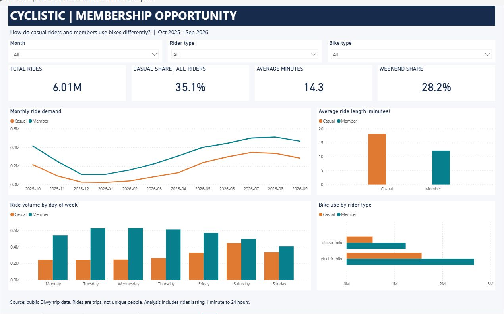

# Cyclistic Bike-Share Analysis

**Case study and Power BI report** · [Portfolio](https://github.com/MohammadKhairJaradat) · [CV](https://github.com/MohammadKhairJaradat/MohammadKhairJaradat/blob/main/Mohammad_Khair_Jaradat_CV.pdf)

**Python · SQL · Power BI**

A Google Data Analytics capstone project comparing casual riders and members. Cyclistic is a fictional company; this analysis uses real public Divvy trip data from Chicago.

## Business question

How do casual riders and members use bikes differently, and where should Cyclistic test annual membership offers?

The project follows **Ask → Prepare → Process → Analyze → Share → Act**. It covers data cleaning, descriptive statistics, SQL, a three-page Power BI report, and three proposed campaign tests.



## Data and findings

**Period:** 1 October 2025–30 September 2026. The 12 monthly files contain **6,171,785 trips**; **6,007,154 remain after cleaning**. No sample was used.

| Metric | Casual | Member |
|---|---:|---:|
| Rides | 2,110,304 | 3,896,850 |
| Share of rides | 35.1% | 64.9% |
| Average minutes | 18.17 | 12.17 |
| Median minutes | 11.14 | 8.69 |
| Weekend share | 37.2% | 23.3% |

- Casual trips were **1.49 times longer** on average.
- **46.4%** of casual trips occurred in June–August 2026.
- Casual trips had a **37.2% weekend share**, compared with **23.3%** for members: a **13.9 percentage-point gap**. Both rider groups peaked around **17:00**.
- **Navy Pier** led recorded casual start stations. About **20.5%** of casual trips had no start-station name.

### Three recommendations

1. Test seasonal membership offers before and during summer.
2. Test weekend and regular-use messages based on each group's riding pattern.
3. Pilot offers at high-volume casual start stations, with a control group to measure sign-ups and cost per conversion.

These are proposed tests. Trip records describe rides, not unique people, and do not show purchase motives, revenue, or campaign outcomes.

## Open the dashboard

Download the repository files and open [Cyclistic.pbix](power_bi/Cyclistic.pbix) in **Power BI Desktop**. The file includes the imported data; Python and raw downloads are not needed to view it.

| Page | Main content |
|---|---|
| Overview | Ride totals, duration, weekend share, monthly demand, and bike use |
| Riding Patterns | Hourly shares, weekday duration, and weekday/weekend use |
| Campaign Planning | Top 10 named casual start stations, coverage, and proposed tests |

Use the **month, rider type, and bike type slicers** on the first two pages. The campaign page focuses on casual trips and has month and bike filters. Slicers are independent between pages.

The editable [PBIP project](power_bi/Cyclistic.pbip), DAX measures, and setup instructions are in [power_bi/README.md](power_bi/README.md). Before refreshing on your computer, set **DataFolder** to your copy of `data/processed`.

## Run the analysis

Use **Python 3.11 or newer**. From the project folder:

```bash
pip install -r requirements.txt
python src/02_analyze_data.py
```

Processed tables are included, so this runs the analysis, executes the seven SQL queries, and exports the charts without downloading raw data.

To reproduce cleaning, download the 12 ZIPs in [source_manifest.csv](data/source_manifest.csv) from the [official archive](https://divvy-tripdata.s3.amazonaws.com/index.html) into `data/raw`, then run:

```bash
python src/01_prepare_data.py
python src/02_analyze_data.py
```

The preparation script verifies source hashes and reads directly from ZIPs, one month at a time. Original download metadata is preserved. Cleaning rules and duration sensitivity are documented in [methodology.md](reports/methodology.md).

## Project files

| Path | Contents |
|---|---|
| `src/` | Two Python scripts |
| `sql/analysis.sql` | Seven queries: grouping, joins, CTEs, and `LAG` |
| `data/processed/` | Analysis tables, dashboard inputs, and SQL results |
| `power_bi/` | PBIX, editable PBIP source, DAX, and report previews |
| `reports/case_study.md` | Findings, recommendations, and limits |
| `reports/methodology.md` | Cleaning decisions and validation approach |

## Checks and sources

Counts reconcile from source to cleaned trips. SQL results agree with pandas. Duration averages are weighted by trip count. Power BI measures and filter behavior were checked in Desktop; verification records are in [validation.json](reports/validation.json) and [power_bi_validation.json](reports/power_bi_validation.json).

Validated with Python 3.14.6, pandas 3.0.5, NumPy 2.5.2, and Matplotlib 3.11.1. Dependency ranges are in `requirements.txt`.

Data: [Divvy system data](https://divvybikes.com/system-data), under the [Divvy Data License Agreement](https://divvybikes.com/data-license-agreement). This is an independent educational analysis. Raw ZIPs, cleaned trip-level files, local caches, and the supplied course packet are excluded from Git. The processed tables and native Power BI files are included.
