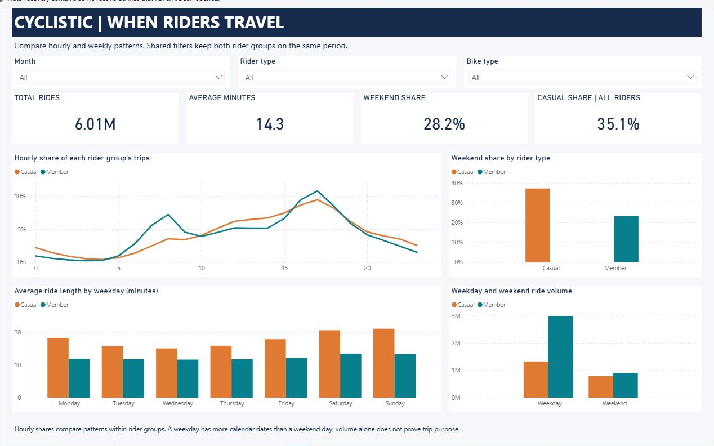
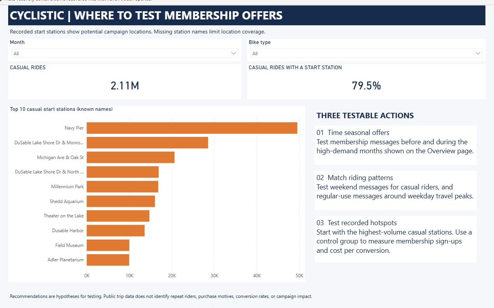

# Power BI Report

Open **[Cyclistic.pbix](Cyclistic.pbix)** in Power BI Desktop for direct viewing. It includes the imported data and is included in the repository. No cloud workspace, sign-in, or Python setup is required for viewing.

Use [Cyclistic.pbip](Cyclistic.pbip) to edit the report source. Configure its data folder before refreshing.

## Pages

1. **Overview:** total rides, casual share, average duration, weekend share, monthly demand, weekday use, and bike types.
2. **Riding Patterns:** hourly shares, weekend shares, weekday duration, and day-type volume.
3. **Campaign Planning:** top 10 named casual start stations, station coverage, and three proposed tests.

Month and bike dimensions filter both trip and station tables. Rider filters are available on the first two pages. The third page deliberately compares casual station activity. Page slicers are independent; use the same selections when comparing pages. Click a chart to filter or highlight other visuals on that page. Clear selections to return to the full-period view.

## On another computer

The report files use `C:/Cyclistic/data/processed` as a neutral **DataFolder** placeholder. The imported PBIX data still supports local viewing.

For PBIP, close the report, run `python power_bi/set_data_folder.py` from the project root, then reopen `Cyclistic.pbip` and refresh. This uses your copy's `data/processed` folder.

For PBIX, set **DataFolder** through **Transform data > Edit parameters** before refreshing. The six input CSVs are included. Raw files are needed only to rerun cleaning.

Before sharing an edited PBIP source, close it and run `python power_bi/set_data_folder.py --portable` to restore the neutral path. For an edited PBIX, restore that parameter in Desktop before saving the shared copy.

## Model and measures

- `Trips`: one row per date, hour, rider type, and bike type.
- `Stations`: one row per month, rider type, bike type, and start-station name.
- `Month`, `Rider`, `Bike`: shared dimensions with one-to-many relationships.
- `Quality`: full-period source and cleaning totals; it is a separate audit table.

Measures are listed in `measures.dax`. Ride counts use `SUM`, because model rows represent groups of trips. Average duration uses a weighted calculation. The casual-share card compares casual trips with all riders under the selected month and bike filters; it intentionally ignores the rider slicer for its denominator. Hourly shares are calculated separately within each rider group.

The report source uses PBIP/PBIR and a JSON semantic model. Local `.pbi` caches are excluded from Git. The top-station measure uses trip count and station name as a tie-breaker, so filtered views contain at most ten stations.

## Previews

These screenshots show the native report. Use the PBIP or PBIX file to interact with it.

