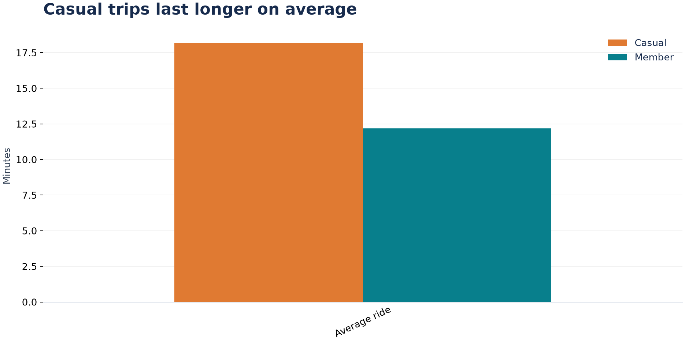
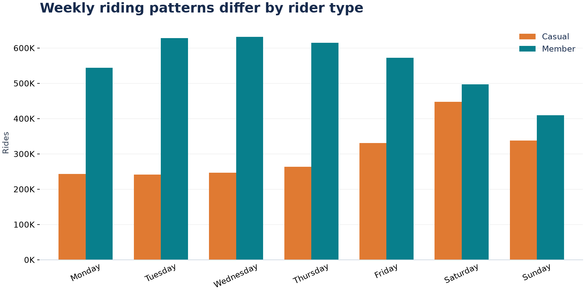
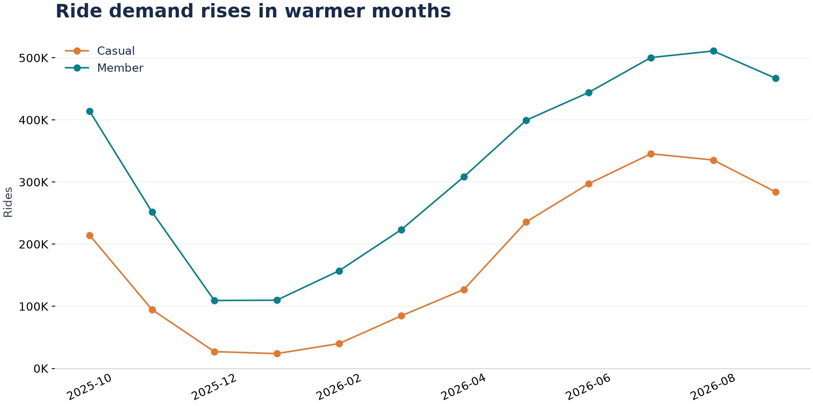
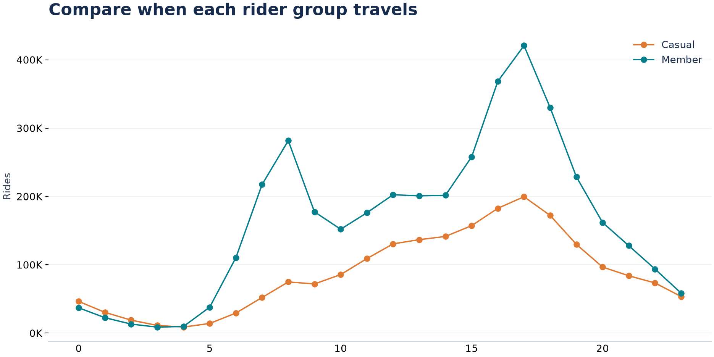

# Cyclistic: Casual Riders and Members

## Business task

Identify differences in bike use between casual riders and members to guide three membership campaign tests. This project follows the course's Ask, Prepare, Process, Analyze, Share, and Act framework.

## Scope

October 2025-September 2026. The 12 monthly files contain 6,171,785 trips. After documented cleaning, 6,007,154 trips remain. Cyclistic is fictional; the records are public Divvy trips from Chicago. The data labels `member` and `casual` are used as supplied, without inferring the exact membership plan purchased.

## Key findings

| Metric | Casual | Member |
|---|---:|---:|
| Rides | 2,110,304 | 3,896,850 |
| Share of rides | 35.1% | 64.9% |
| Average minutes | 18.17 | 12.17 |
| Median minutes | 11.14 | 8.69 |
| Weekend share | 37.2% | 23.3% |

**1. Casual trips last longer.** Their mean duration is 1.49 times the member mean. The medians are also higher, so the difference is not only driven by extreme trips. Average duration differs from the typical trip because durations are right-skewed.

**2. Casual trips have a stronger weekend pattern.** 37.2% of casual trips start on Saturday or Sunday, compared with 23.3% of member trips. Saturday is the busiest casual day. This supports testing weekend messages; it does not prove that those trips are leisure trips.

**3. Demand is seasonal.** 46.4% of casual trips occur in June-August 2026. Casual volume peaks in July; overall volume peaks in August. Plan tests around observed demand and compare them against a control during the same season.

**4. Both groups peak around 17:00.** Members also have a visible morning peak. These times suggest a test for regular travel needs, but trip purpose and repeated use cannot be measured from anonymous trips.

**5. Navy Pier leads the recorded casual start stations.** It has the highest casual count among named starts. About 20.5% of casual trips lack a start-station name, so this is a partial view of locations.

## Top three recommendations

| Test | Evidence | Measure of success |
|---|---|---|
| Seasonal membership offer | High casual volume in June-August | Incremental sign-ups versus a same-period control |
| Weekend and regular-use messages | Higher casual weekend share; travel peaks around 17:00 | Incremental conversion by message and time window |
| Pilot at recorded casual hotspots | Navy Pier and other named locations have high casual volume | Incremental conversions and cost per conversion |

Use small pilots before a wider campaign. Collect purchase and campaign outcomes with consent. Avoid assuming that a high trip count means many unique or repeat customers.

## Limits

The records do not include unique riders, revenue, marketing exposure, or membership purchases. They cannot establish why casual users buy memberships, how many would convert, or the return on a campaign. Duration cutoffs and missing station names affect coverage; both are documented in [methodology.md](methodology.md).

## Deliverables

Business task and sources: this report and the README. Cleaning: the preparation script, method, and cleaning log. Analysis: Python outputs and SQL queries. Visuals: the editable three-page Power BI report and PNG charts. Actions: the three pilot recommendations above.
